# EduReserve Developer Guide

## Table of contents

- [Acknowledgements](#acknowledgements)
- [Setup](#setting-up-getting-started)
  - [Prerequisites](#prerequisites)
  - [Setting up the project](#setting-up-the-project)
- [Design & implementation](#design--implementation)
  - [Overall class diagram](#overall-class-diagram)
  - [Creating a booking: book](#creating-a-booking-book)
  - [Listing bookings: list](#listing-bookings-list)
  - [List available venues: free](#list-available-venues-free)
  - [View booking: viewbooking](#view-booking-viewbooking)
  - [Editing a booking: editbooking](#editing-a-booking-editbooking)
  - [Checking attendee counts: checksize](#checking-attendee-counts-checksize)
  - [Saving and loading bookings: storage](#saving-and-loading-bookings-storage)
  - [Cancelling a booking: cancel](#cancelling-a-booking-cancel)
  - [Finding bookings: find](#finding-bookings-find)
  - [Preventing booking clashes: book](#preventing-booking-clashes-book)
  - [Daily calendar: calendar](#daily-calendar-calendar)
  - [Undoing a command: /undo](#undoing-a-command-undo)
  - [Redoing a command: /redo](#redoing-a-command-redo)
- [Product scope](#product-scope)
  - [Target user profile](#target-user-profile)
  - [Value proposition](#value-proposition)
- [User Stories](#user-stories)
- [Non-Functional Requirements](#non-functional-requirements)
- [Glossary](#glossary)
- [Appendix E: Instructions for Manual Testing](#appendix-e-instructions-for-manual-testing)
## Setting up, getting started
### Prerequisites

Install the following tools:
  - **JDK 25** to compile and run EduReserve.
  - **Git** to manage the source code.
  - **IntelliJ IDEA** with Java 25 support.

A separate Gradle installation is unnecessary because the project includes
the Gradle Wrapper.

### Setting up the project

1. Fork the [EduReserve repository](https://github.com/AY2627S1-CS2113-W14-2/tp)
   into your GitHub account.

2. Clone your fork onto your computer:

   ```git clone https://github.com/YOUR_USERNAME/tp.git```

3. Open the cloned tp folder in IntelliJ IDEA and import it as a
Gradle project. Allow Gradle to finish downloading dependencies.

4. Configure Java 25:
   - Under File → Project Structure → Project, select JDK 25 as the Project SDK.
   - Under Settings → Build, Execution, Deployment → Build Tools → Gradle,
    select JDK 25 as the Gradle JVM.
   - Use the project's Gradle Wrapper as the Gradle distribution.

5. Verifying the setup

    Run the following commands from the project root, which contains build.gradle.

    Windows PowerShell:

    `.\gradlew.bat run`

    macOS or Linux:

    `./gradlew run`

    Enter a username if prompted, then try the inputs listed in [manual testing](#instructions-for-manual-testing)
6. Storage

    Bookings and the username are saved in the data folder relative to
    the application's working directory. 
7. Running automated checks

    Run the tests and Checkstyle checks before submitting changes.

    Windows PowerShell:

    `.\gradlew.bat check`

    macOS or Linux:

    `./gradlew check`

    A successful run ends with BUILD SUCCESSFUL.

    The test report is generated at build/reports/tests/test/index.html.
   
## Acknowledgements
- [CS2113 Java project template](https://github.com/NUS-CS2113-AY2627-S1/tp): Initial project structure, Gradle wrapper, build and CI configuration, Checkstyle configuration, and documentation templates adapted for EduReserve.
- [AddressBook Level 3 Developer Guide](https://se-education.org/addressbook-level3/DeveloperGuide.html#proposed-undoredo-feature): Organizational structure adapted for this guide.
- [SE-EDU Java coding standard (basic + intermediate)](https://se-education.org/guides/conventions/java/intermediate.html): The coding standard followed by all collaborators on the project
- [SE-EDU Git conventions](https://se-education.org/guides/conventions/git.html): Referenced for commit message formatting.
- [Gradle](https://gradle.org/): Used to automate building, testing and checking the project.
- [PlantUML](https://se-education.org/guides/tutorials/plantUml.html) for creating UML diagrams to document the project’s design.
- [JUnit](https://junit.org/): Used to write and run automated tests for commands, parsing, storage and UI behaviour.
- [Checkstyle](https://checkstyle.org/): Used to check Java source code against the project's coding standards.
- [NUSMods](https://nusmods.com/venues): Referenced when compiling the preset venue names in VenueCatalog.

## Design & implementation

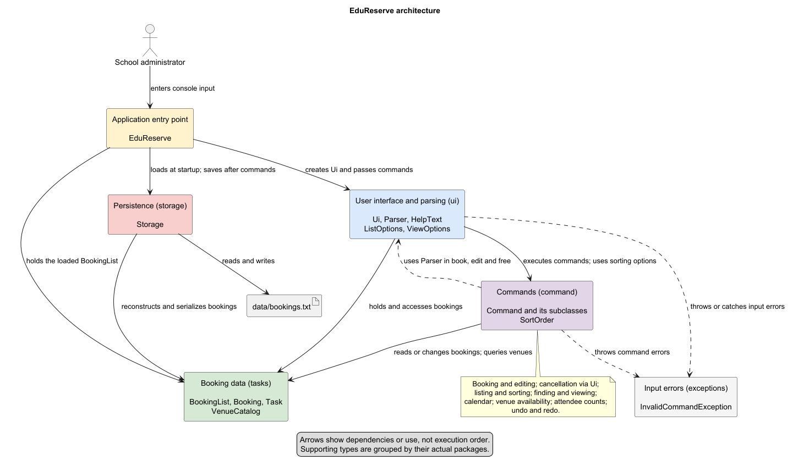

### Overall class diagram

The diagram below shows the main application classes, their inheritance relationships and
selected dependencies. Classes are grouped by their Java packages.
`Task` and `Command` are abstract classes, marked with `{abstract}`. The same label on
`Command.execute` denotes an abstract method. Solid lines with hollow triangles point to
superclasses; directed solid lines show navigable associations, and dashed arrows show dependencies.

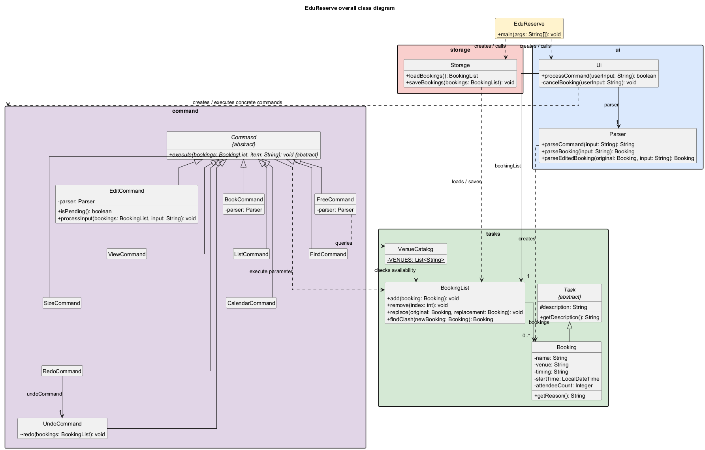

`EduReserve` creates the UI and storage objects and passes the loaded `BookingList` to `Ui`.
`Ui` uses `Parser` to interpret input and creates or retains concrete command objects to execute
operations. All ten command classes extend `Command`; cancellation is handled directly in `Ui`.
`RedoCommand` refers to the same `UndoCommand` retained by `Ui`, so both use one session history.

`BookingList` holds references to `Booking` objects, which inherit their reason (the `description`
field) from `Task`. `Storage` loads and saves these bookings, while `VenueCatalog` supplies the
preset venues and checks their availability against the booking list. The plain association
between `BookingList` and `Booking` allows the same immutable booking objects to also appear
in search results and undo/redo snapshots.

For readability, only selected members and relationships are shown. Help text, parsing option
types, sorting options, exceptions, private history records and Java library classes are omitted.
Parser fields in the command classes denote retained references; each concrete command overrides
`execute(BookingList, String)`.

[Editable PlantUML source](UMLDiagrams/OverallClassDiagram.puml)

The command sequence diagrams below show the user calling `Ui` directly, with the application
entry point omitted. Arrows back to the user represent console output. Loading and saving are
shown separately in the storage diagram. Its `User` actor represents user-triggered application
activity; `EduReserve` performs the actual storage calls and is omitted from the diagram.

### Creating a booking: book

Adds a named exam or lecture booking.

Format: `book r/BOOKING_REASON n/BOOKING_NAME v/VENUE t/TIMING`

- All four fields are required and must appear in the order `r/`, `n/`, `v/`, `t/`.
- The reason must be `exam` or `lecture` (case-insensitive).
- The name and venue must not be blank and may contain spaces.
- Timing must be a valid date and time in `dd/MM/yyyy HH:mm` format.

Example: `book r/exam n/CS2113 Midterm v/LT1 t/05/10/2026 14:00`

Add an optional attendee count after the timing as `a/ATTENDEES`, for example:
`book r/exam n/CS2113 Midterm v/LT1 t/05/10/2026 14:00 a/80`.
The count must be a positive whole number. Bookings without a count have an unknown size.

`Ui.processCommand` identifies the command and creates a `BookCommand`, passing it the existing
`Parser`. `BookCommand.execute` passes the full input to `Parser.parseBooking`, which validates
the fields and constructs a `Booking`. The command then calls `BookingList.add` and prints the
confirmation. `Ui` prints the separator and returns `false` so the application continues.

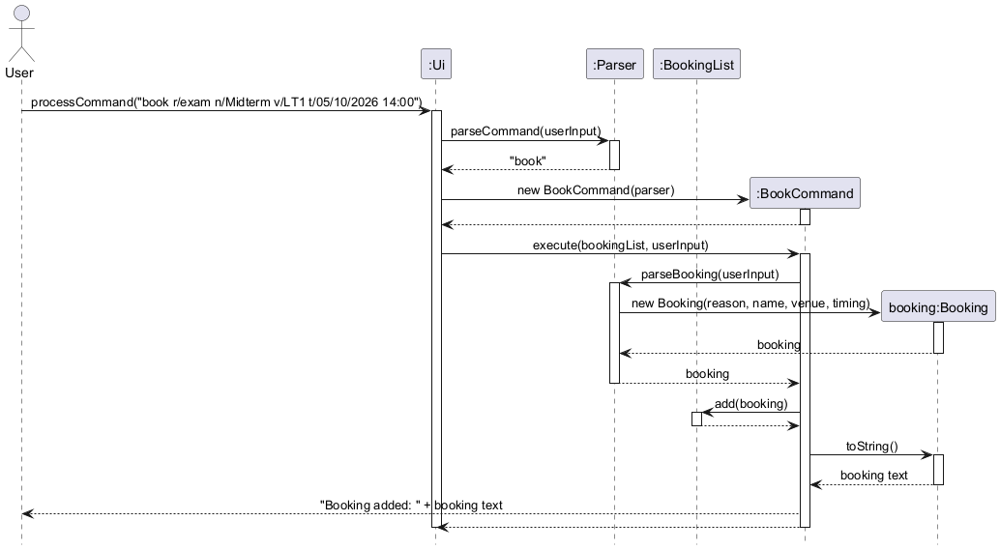

The diagram shows a successful booking; validation internals and storage are omitted for clarity.
If validation fails, `Parser` throws `InvalidCommandException` before a booking is added.
The exception propagates through `BookCommand` to `Ui`, which displays the error and command help.
After `processCommand` returns, `EduReserve` saves the booking list using `Storage.saveBookings`.

[Editable PlantUML source](UMLDiagrams/BookingSequenceDiagram.puml)

### Listing bookings: list
Displays the bookings, with optional filtering and sorting by name or date and time

Format: `list [r/REASON] [s/SORT_ORDER]`

Square brackets indicate optional arguments, do not type them.

- `REASON` must be either exams or lectures
- `SORT_ORDER` must be the following options `alpha` for A to Z, `~alpha` for Z to A, `time` for earliest to latest time and `~time` for latest to earliest time
- Alphabetical sorting compares booking names, ignoring capitalization
- Omitting `r/REASON` shows all bookings
- Omitting `s/SORT_ORDER` shows the list with original booking orders preserved
- The arguments may be swapped to appear in any order first, and can only be specified once
- Time sorting is unavailable if a selected booking lacks a valid date and time

Examples:

|          Command           |                    Result                     |
|:--------------------------:|:---------------------------------------------:|
|           `list`           |               Show all bookings               |
|       `list r/exams`       |            Show all exam bookings             |
|       `list s/alpha`       |     Show all bookings sorted from A to Z      |
| `list r/lectures s/~alpha` |     Show all lectures sorted from Z to A      |
|   `list r/exams s/time`    | Show all exams sorted from earliest to latest |

Parser.parseViewList() validates the optional reason and sorting arguments, returning a ListOptions record. Ui passes these options to ListCommand.execute().

The command clears lastShownList and populates it with all bookings or only those matching the requested reason. It then sorts this display list by name (s/alpha, s/~alpha) or date and time (s/time, s/~time). Without a sorting option, insertion order is preserved.

Finally, the command prints the selected bookings with consecutive numbers starting from 1. Sorting does not change the stored BookingList. Time sorting is rejected if a selected booking lacks a valid parsed date and time.

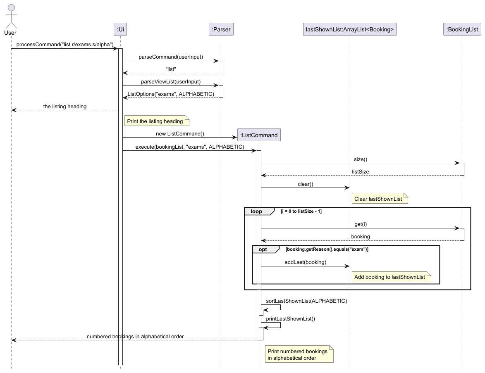
### List available venues: free
Displays a list of all available venues at a user specified time

Format: `free t/TIMING`

- `TIMING` must use the `dd/MM/yyyy HH:mm` format
- `TIMING` is the start of the one-hour slot being checked
- The command searches preset venues and does not create a booking
- A venue is excluded if an existing booking overlaps the requested hour
- Bookings ending exactly when the requested slot starts are allowed
Examples:

|          Command          |                              Result                              |
|:-------------------------:|:----------------------------------------------------------------:|
| `free t/28/10/2026 14:00` | Show all available venues from 14:00 to 15:00 on 28 October 2026 |

Parser.parseFreeTime() validates the requested date and time. FreeCommand passes it to VenueCatalog.findAvailableVenues(), which checks each preset venue through BookingList.isVenueAvailable(). This method uses Booking.overlaps() to exclude venues with bookings overlapping the requested one-hour slot. Venue matching ignores capitalization, and adjacent slots are allowed. Results are numbered, and stored bookings remain unchanged.

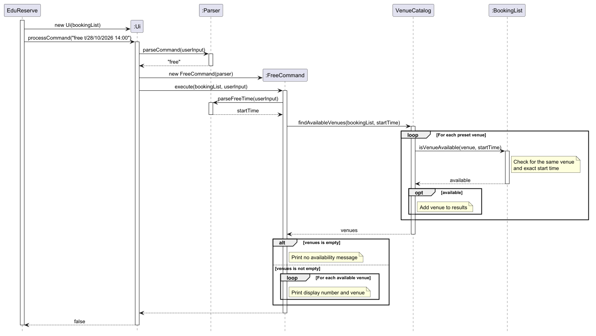

### View booking: viewbooking
Displays the details of the bookings under the same name, with optional time filtering

Format: viewbooking [n/BOOKING_NAME] [s/time]

Second argument is optional

- BOOKING_NAME must be a valid name in the booking list
- Sorting compares booking timings
- Omitting s/time shows the list with original booking orders preserved

Examples:

|             Command              |                               Result                                |
|:--------------------------------:|:-------------------------------------------------------------------:|
|    `viewbooking n/mybooking`     |    Show all bookings under the name "mybooking" in booking order    |
| `viewbooking n/mybooking s/time` | Show all bookings under the name "mybooking" in the order of timing |

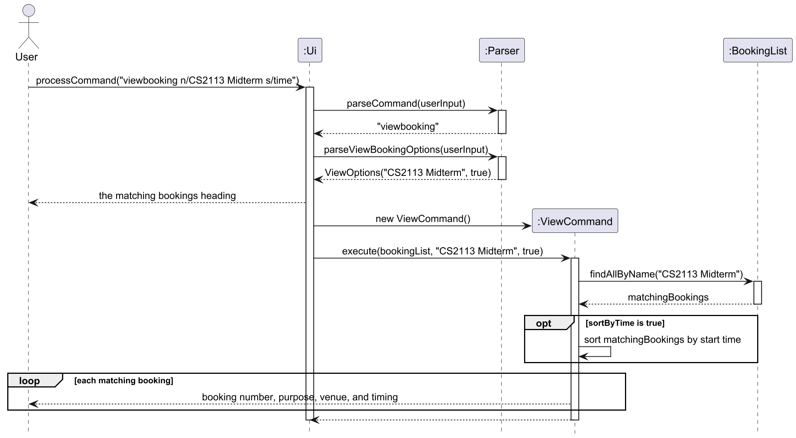

### Editing a booking: editbooking

Format: `editbooking n/BOOKING_NAME`

- Matches the full booking name, ignoring case; partial names are not matched.
- If multiple bookings match, a numbered list shows their reason, venue, and timing.
  Enter the number from this filtered list to select the booking to edit.
- With one match, the booking is selected automatically.
- At the editing prompt, enter one or more fields: `r/REASON`, `n/NAME`, `v/VENUE`, `t/TIMING`.
  These fields may appear in any order, once each. Omitted fields keep their existing values.
- Add optional `a/ATTENDEES` at the end to update the booking size.
- Reasons must be `exam` or `lecture`; timing must use `dd/MM/yyyy HH:mm`.
- Each booking lasts one hour. Edited bookings must not overlap another booking in the same venue;
  a booking starting exactly when another ends is allowed, including across midnight.
- Invalid input or a venue/time clash leaves the original booking unchanged and allows a retry.
- Type `abort` to cancel editing, or `bye` to exit without applying changes.

Example session (two bookings named "Midterm"):

```text
editbooking n/Midterm
2
v/LT3 t/06/10/2026 15:00
```

`Ui` retains an `EditCommand` between input lines. The command uses `BookingList.findAllByName`
to build the filtered selection and retains the selected booking object, so filtered numbers
cannot accidentally select an unrelated booking in the full list. `Parser.parseEditedBooking`
validates a replacement using the same constraints as creating a booking. Clash checking calls
`Booking.overlaps` to use the same one-hour rule as `book`, while excluding the selected original booking
so it cannot clash with itself. `BookingList.replace` applies the change in its original position
only after validation succeeds. The existing application loop saves the updated list.

[Editable edit booking sequence diagram](UMLDiagrams/EditBookingSequenceDiagram.puml)

### Checking attendee counts: checksize

The `checksize` command reports the largest recorded attendee count for each venue. Bookings without
an attendee count are omitted, and no venue capacity values are required.

Format: `checksize`

The command groups bookings by venue and prints the largest attendee count recorded for each venue.
Bookings without `a/ATTENDEES` do not contribute to the results.

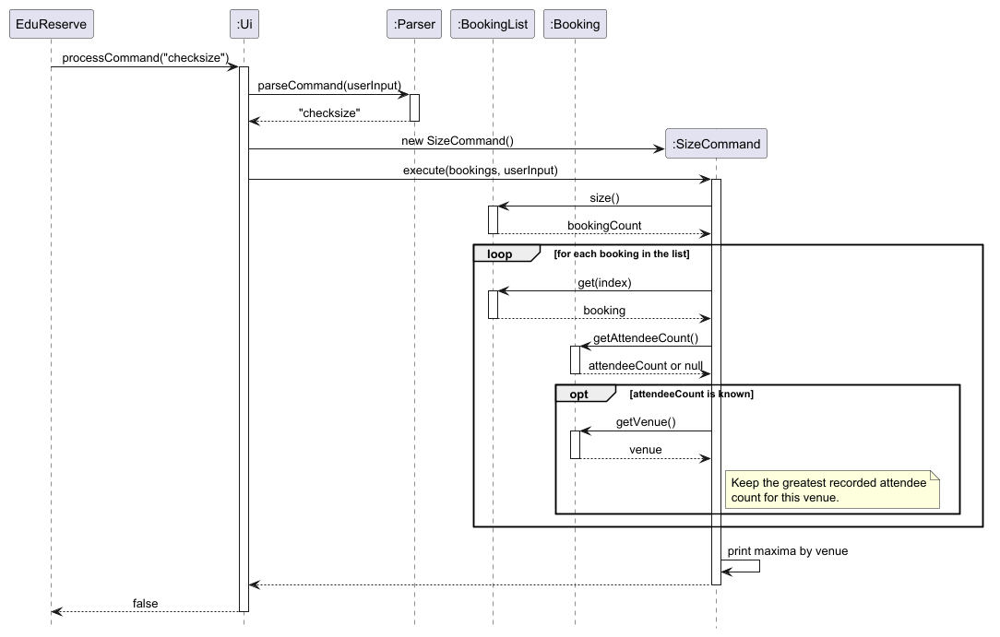

### Saving and loading bookings: storage

Saves one username and the booking list to text files. It loads them again when EduReserve starts.

The first time EduReserve starts, `loadUserName` returns `null` because `data/username.txt` does not exist.
EduReserve asks for a username and calls `saveUserName`. Later runs load this username and skip the question.
Only one username is stored because EduReserve is a single-user application.

Data format:

`B | BOOKING_REASON | BOOKING_NAME | VENUE | TIMING | ATTENDEES`

Example:

`B | exam | Midterm | LT1 | 05/10/2026 14:00 | 80`

- Each booking is stored on one line.
- The attendee count is optional.
- Bookings are stored in `data/bookings.txt`.
- The file uses UTF-8.

When EduReserve starts, it creates a `Storage` object and calls `loadBookings`. If the data file
does not exist, an empty file is created. `Storage` reads each nonblank line and passes it to
`parseBooking`. The method checks the fields and creates a `Booking`. The booking is then added
to the `BookingList`.

After a command is processed, EduReserve calls `saveBookings`. The method goes through the current
booking list and passes each booking to `bookingToLine`. This method gets the reason, name, venue,
timing and attendee count from the booking. The completed lines are then written to
`data/bookings.txt`. `saveBookings` reads the file's last modified time after writing and returns it.
EduReserve formats this time and displays it so the user can confirm that the booking file was saved.

The storage also supports booking files created before attendee counts were added. An older line
has five parts while a new line has six parts. For an older booking, the attendee count is set to
`null`. When the booking list is saved again, it is written using the new format. A saved attendee
count must be a positive whole number. Invalid booking data causes an `IOException`, which
EduReserve catches and reports to the user.

A plain-text file was used because the booking data has a small and fixed format. It is also easy
to read and does not need another library. JSON was considered, but it would add extra parsing for
the current amount of data. Requiring only the new format was also considered, but older booking
files would no longer load.

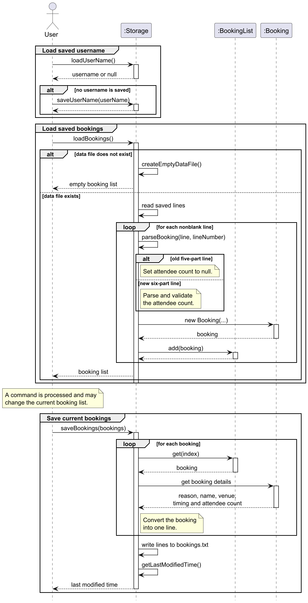

The diagram shows the loading and saving of bookings. File operations, validation details and
exception handling are omitted for clarity.

[Editable PlantUML source](UMLDiagrams/StorageSequenceDiagram.puml)

### Cancelling a booking: cancel
Removes a booking so that its venue and time can be used again

Format: cancel n/BOOKING_NAME

- BOOKING_NAME is not case sensitive and may contain spaces
- If several bookings share the same name, only the first one in the list is cancelled. `book` rejects duplicate names, so this mainly affects older saved data.
- An error is shown if no booking has that name, and the list is left unchanged

Examples:

|            Command             |                          Result                           |
|:------------------------------:|:---------------------------------------------------------:|
|   `cancel n/CS2113 Midterm`    |        Cancel the booking named "CS2113 Midterm"          |
|   `cancel n/cs2113 midterm`    | Same booking as above, as capitalization is ignored       |

Implementation: `Ui#cancelBooking` calls `Parser#parseCancel` to extract the name, `BookingList#findByName` to get the
index of the first match (or -1), and `BookingList#remove` to delete it. Assertions check that the index is inside the
list and that the list shrinks by exactly one, while user mistakes such as a missing name throw
`InvalidCommandException`.

Design consideration: cancelling by name instead of by list number. `viewbooking`, `editbooking` and `find` already
identify bookings by name, so `cancel` works the same way. A list number is risky because it changes whenever the list
is filtered, sorted, cancelled from or undone, so a number read from an old `list` could cancel the wrong booking.
The trade-off is that the full name must be typed, which is acceptable because `book` requires names to be unique.
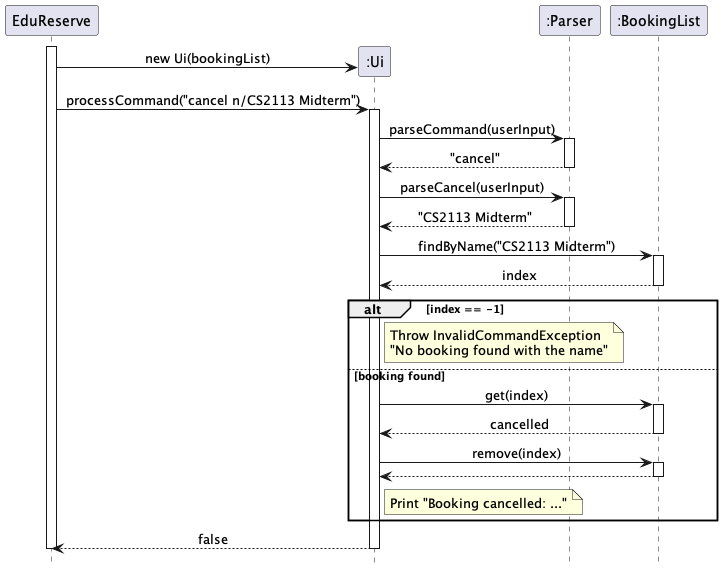

### Finding bookings: find
Shows every booking whose name contains a keyword

Format: find n/KEYWORD

- KEYWORD is not case sensitive and may contain spaces
- A booking matches if its name contains the keyword anywhere, not just at the start
- Matches are shown in their original order, with their venue and timing
- If nothing matches, a message says so. The booking list is never changed

Examples:

|        Command         |                                        Result                                         |
|:----------------------:|:-------------------------------------------------------------------------------------:|
|     `find n/CS2`       | Show both "CS2113 Midterm" and "CS2445 Final Exam"                                    |
|    `find n/CS2113`     | Show only "CS2113 Midterm"                                                            |
|   `find n/final exam`  | Show only "CS2445 Final Exam"                                                         |

Implementation: `Parser#parseFind` extracts the keyword, `Ui` passes it to `FindCommand`, and `FindCommand` calls
`BookingList#findByKeyword` and prints each match. Assertions check that the keyword is not blank, that every result
contains the keyword and that the list size is unchanged.

Design consideration: partial, case-insensitive matching instead of matching the full name. Admins often remember only
part of a booking name, such as the module code `CS2113`, and exact lookup by full name is already covered by
`viewbooking`, `cancel` and `editbooking`. The trade-off is that a very short keyword can match many bookings, which is
acceptable because the results are only displayed and the list is never changed.
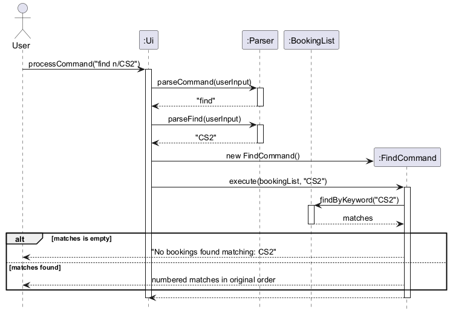

### Preventing booking clashes: book
A new booking is rejected if its venue is already booked at an overlapping time

Format: book r/BOOKING_REASON n/BOOKING_NAME v/VENUE t/TIMING (same as before)

- Every booking lasts 1 hour from its start time, so a booking at 12:00 occupies 12:00 to 13:00
- A clash means an existing booking with the same venue (not case sensitive) whose hour overlaps the new booking's hour
- A booking that starts exactly when another ends does not clash, so 12:00 and 13:00 can both be booked
- Older saved bookings without a full dd/MM/yyyy HH:mm timing are not checked
- Cancelling the existing booking frees the venue and time again
- `editbooking` and `free` use the same rule, so all three commands always agree

Examples, assuming `book r/exam n/CS2113 Midterm v/LT1 t/05/10/2026 12:00` already exists (it occupies 12:00 to 13:00):

|                       Command                       |                Result                |
|:---------------------------------------------------:|:------------------------------------:|
| `book r/lecture n/Week 1 v/lt1 t/05/10/2026 12:00`  |  Rejected: LT1 is already booked     |
| `book r/lecture n/Week 1 v/LT1 t/05/10/2026 12:01`  |  Rejected: overlaps 12:00 to 13:00   |
| `book r/lecture n/Week 1 v/LT1 t/05/10/2026 11:01`  |  Rejected: runs into 12:00           |
| `book r/lecture n/Week 1 v/LT1 t/05/10/2026 13:00`  |  Added: starts as the first ends     |
| `book r/lecture n/Week 1 v/LT1 t/05/10/2026 11:00`  |  Added: ends as the first starts     |
| `book r/lecture n/Week 1 v/LT2 t/05/10/2026 12:00`  |  Added: different venue              |

Implementation: `BookCommand` calls `BookingList#findClash` once `Parser#parseBooking` succeeds. `findClash` asks each
existing booking whether `Booking#overlaps(venue, startTime)`, which is true when the venue matches (ignoring case) and
the new start is before the existing end and the existing start is before the new end. A booking's end is its start plus
`Booking.DEFAULT_DURATION` (1 hour). The first overlapping booking is returned, or null if the venue is free. A clash is
reported as an `InvalidCommandException`, so the new booking is never added. `BookingList#isVenueAvailable` (used by
`free`) and `EditCommand` call the same `Booking#overlaps` method, so the rule is defined in one place.

Design consideration: a fixed 1-hour duration instead of an end time entered by the user. A booking only stores its
start time, so letting the user type an end time or duration would change the `book` format and the saved file format,
and older saved bookings would need converting. With a fixed duration the end time is calculated, nothing new is saved,
and `Booking.DEFAULT_DURATION` is the only value to change if the length ever changes. The trade-off is that a longer
exam cannot block its venue for its full length. An optional duration field could be added later by storing it in
`Booking` and using it in `Booking#getEndTime`.
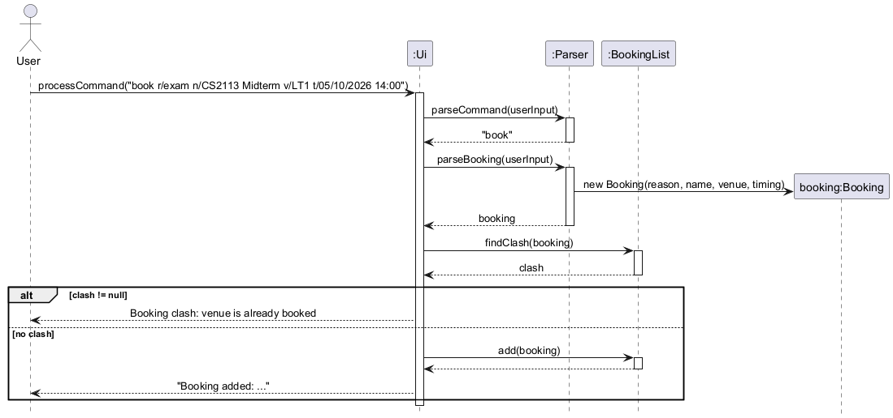

### Daily calendar: calendar
Shows the bookings that start today, with their start times

Format: calendar

- Takes no arguments, and extra words are rejected
- Today is read from the computer's clock
- Bookings are shown earliest first, with start time, purpose, name and venue
- A booking appears on the day it starts, even if its 1-hour slot runs past midnight
- Older saved bookings without a full date are skipped
- If nothing starts today, "No bookings on dd/MM/yyyy." is shown

Example output:

```
Calendar for 05/10/2026:
1. 09:00 - lecture - Week 1 Lecture (venue: LT2)
2. 14:00 - exam - CS2113 Midterm (venue: LT1)
```

Implementation: `Parser#parseCalendar` checks there are no extra words and `Ui` calls
`CalendarCommand#execute(bookings, "today")`. That method calls `CalendarCommand#execute(bookings, LocalDate)`, which
asks `BookingList#findByDate` for the bookings starting on that date, sorted by start time, and prints them. The
`LocalDate` version exists so that tests can check the output for a fixed date instead of depending on today's date.

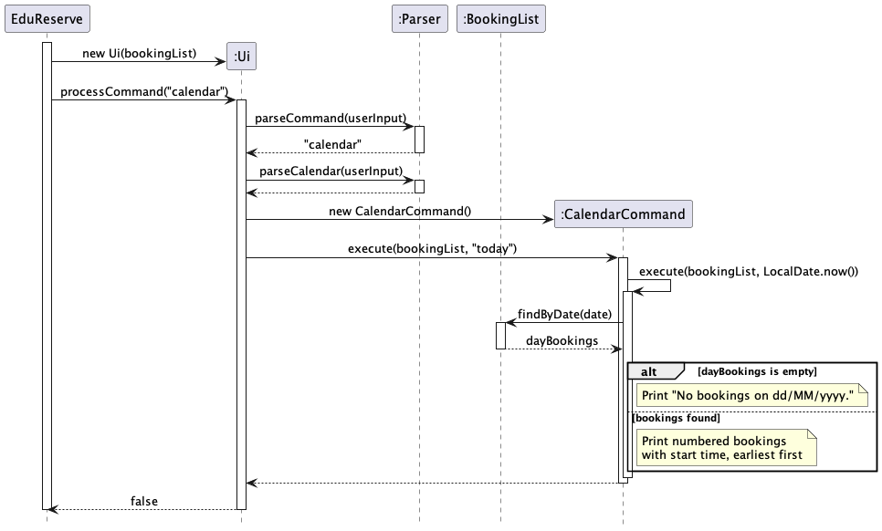

### Undoing a command: /undo

Restores the booking list to its state before the most recent successful `book` or `cancel` command.

Format: `/undo`

`Ui` keeps one `UndoCommand` instance for the session. Its `isUndoable` method declares the eligible
commands. Before executing one of these commands, `executeAndRecord` copies the current booking list.
Only after the command succeeds does it push an `UndoEntry` containing the before and after snapshots and
the full command text onto `history`, then clear `redoHistory`. Failed commands and read-only commands
do not add entries or clear redo history.

When `/undo` is entered, `Ui.processCommand` calls `UndoCommand.execute`. It reads the latest history entry,
removes the current bookings and adds the saved bookings back in their original order. It then pops the
history entry, pushes it onto `redoHistory`, and prints the full command that was undone, for example:

```text
Undid command: book r/exam n/Midterm v/LT1 t/05/10/2026 14:00
```

If history is empty, it prints `No commands to undo.` and leaves the bookings unchanged. Extra arguments
such as `/undo extra` are rejected with `InvalidCommandException`, which `Ui` catches and displays with help.
Repeated `/undo` commands restore earlier states; undo itself is never recorded.

After `processCommand` returns, `EduReserve` calls `Storage.saveBookings` to write the current list to
`data/bookings.txt`. The restored bookings persist across restarts, but undo history lasts only for the
current session. A save failure is reported by `EduReserve` as `Unable to save your bookings.`

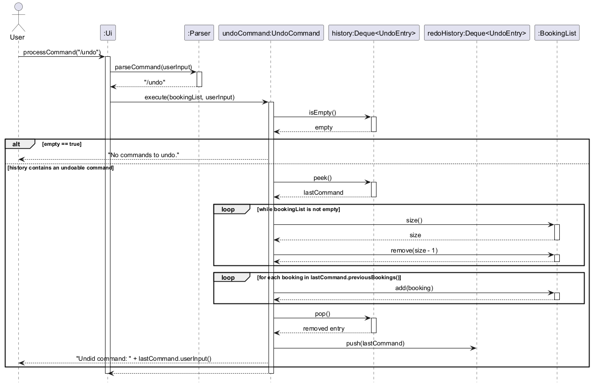

The diagram covers a valid `/undo` request, including empty history and the transfer to redo history.
Validation details, separator output and persistence are omitted for clarity.

[Editable PlantUML source](UMLDiagrams/UndoCommandSequenceDiagram.puml)

### Redoing a command: /redo

Format: `/redo`

`Ui` keeps a `RedoCommand` linked to the same `UndoCommand` instance used for recording and undoing commands.
`RedoCommand.execute` validates that there are no arguments, then calls `UndoCommand.redo`. This restores
the after snapshot of the most recently undone command, moves its entry from `redoHistory` back to
`history`, and prints `Redid command: ` followed by the full original command. It can then be undone again.
`EduReserve` saves the restored booking list through the same `Storage.saveBookings` call used after undo.

Repeated `/redo` commands reapply commands in reverse undo order. If there is no available entry, the
response is `No commands to redo.` and bookings stay unchanged. Redo history lasts only for the current session.

A successful new `book` or `cancel` command clears **all remaining redo history**, including after a partial
redo. For example, after booking A, B and C, undoing C and B, and redoing B, a new booking D discards the
option to redo C. A failed command or a read-only command such as `list` leaves that option available.

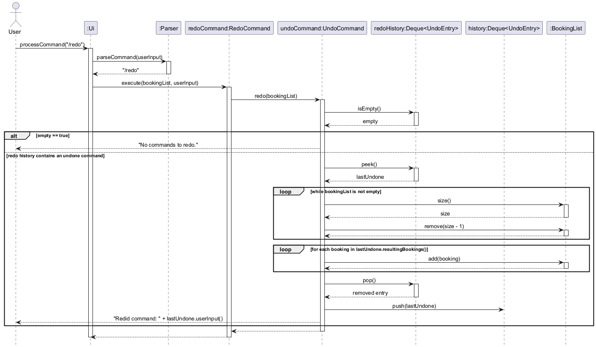

The diagram covers a valid `/redo` request, including empty redo history and the transfer back to undo history.
The two loops expand `restoreBookings`: first clear the current list, then restore the saved **after**
state from `resultingBookings()`. Undo instead restores the **before** state from `previousBookings()`.
Input validation, snapshot helper calls, separator output and persistence are omitted for clarity.

[Editable PlantUML source](UMLDiagrams/RedoCommandSequenceDiagram.puml)

## Product scope
### Target user profile

University educators, School admins

### Value proposition

Exam/room venue booking system for lecturers/School admins to easily avoid/resolve clashes, users can retrieve the info of room status (who has booked the room -on a first come first serve basis)

## User Stories

| Version | As a ...     | I want to ...                                                        | So that I can ...                                                                     |
|---------|--------------|----------------------------------------------------------------------|---------------------------------------------------------------------------------------|
| v1.0    | School Admin | know what features the app has and how to use them                   | I can start to use the app seamlessly                                                 |
| v1.0    | School Admin | Have simple commands                                                 | It’s easier to remember what commands to use and navigate                             |
| v1.0    | School Admin | Book lecture and exam venues                                         | I can keep track of venues that are being used                                        |
| v1.0    | School Admin | Cancel a booking                                                     | Keep the bookings updated in case a class is cancelled                                |
| v1.0    | School Admin | Find bookings by a keyword in their name                             | Quickly locate specific bookings without scrolling through the whole list             |
| v1.0    | School Admin | View a booking                                                       | Check the details of the booking under a name                                         |
| v1.0    | School Admin | List bookings filtered by type and sorted alphebetically             | I can view all bookings clearly in an organised manner                                |
| v2.0    | School Admin | Edit a booking                                                       | I can change my booking details if needed                                             |
| v2.0    | School Admin | Check size of venue in terms of attendees                            | Determine I have enough resources to hold the event in the venue                      |
| v2.0    | School Admin | find a to-do item by name                                            | locate a to-do without having to go through the entire list                           |
| v2.0    | School Admin | Add booking notes                                                    | I have an alternative method to convey any messages to students beforehand            |
| v2.0    | School Admin | Undo the previous action                                             | I can rewind accidental actions                                                       |
| v2.0    | School Admin | Redo last undo                                                       | I can redo an action if I accidentally undid it                                       |
| v2.0    | School Admin | Be stopped from booking a venue that is already booked for that time | Avoid double-booking a venue and clashing with other classes                          |
| v2.0    | School Admin | Get a calendar view of today's bookings                              | Quickly be updated on what's scheduled for today without going through the whole list |
| v2.0    | School Admin | View a list of the bookings sorted by time                           | I can clearly see which bookings come after which time                                |
| v2.0    | School Admin | View a list of available venues                                      | I can clearly see which booking slots are free                                        |
| v2.0    | School Admin | Store my username                                                     | I do not have to enter my username every time the program starts                      |
| v2.0    | School Admin | Keep track of when the storage file was last changed                  | I can confirm that my booking changes were saved                                      |

## Non-Functional Requirements

### Portability

* EduReserve shall run on Windows, macOS and Linux using Java 25 and a terminal. Users shall be able to run
  the same application JAR without installing an IDE or rebuilding the project for their operating system.
* File access shall use platform-independent paths relative to the application's working directory, rather
  than absolute paths tied to a developer's computer. Text files shall use UTF-8 encoding.
* Users shall be able to transfer their saved data to another supported computer by copying the `data`
  folder and launching the application from its parent folder. Normal operation shall not require an
  internet connection or an external database.

### Data persistence

* The application shall automatically save the current booking list after processing each nonblank command,
  including successful additions, cancellations, edits, undo and redo operations. Saving shall not require
  a separate user command.
* Bookings shall be stored locally in `data/bookings.txt`, preserving their purpose, name, venue, timing,
  optional attendee count and list order. The username shall be stored separately in `data/username.txt`.
  Both shall be restored when the application is restarted from the same working directory.
* Missing data folders and booking files shall be created automatically on the first run. Invalid or
  unreadable saved booking data shall produce an error and stop loading without overwriting the existing
  bookings file. A failed save shall display an error rather than report success.
* Successfully saved changes shall survive a normal application restart. Undo and redo history and pending
  edits shall remain limited to the current session. Recovery from an interrupted file write or unexpected
  power loss is outside the current persistence guarantee.

### Efficiency

* For a dataset of up to 1,000 bookings, the target processing time for a single command, including its
  automatic save, shall be at most one second. Measure from submission of a complete command or edit input
  until processing finishes; exclude time spent waiting for user input and rendering terminal output.
* Loading up to 1,000 bookings at startup shall have a target duration of at most two seconds, measured from
  the start of file loading until the booking list is ready. Exclude JVM startup and the username prompt.
* These response-time targets require performance testing on a supported computer using Java 25 and local
  storage. Record the test machine's specifications and dataset when checking them; the current unit tests
  do not establish that the targets have been met.

## Glossary

* *Assertion* - A Java `assert` statement that checks something that must always be true in correct code, such as a
  list index being in range. Assertions catch programmer errors, while user mistakes throw `InvalidCommandException`.
  They are enabled when running with Gradle and in tests.
* *Attendees* - The optional expected group size of a booking, given with `a/ATTENDEES`. It must be a positive whole
  number and is used by `checksize`.
* *Back-to-back bookings* - Two bookings in the same venue where the second starts exactly when the first ends,
  for example 12:00 and 13:00. They do not clash.
* *`book`* - Command that creates a booking from a reason, name, venue and timing, with optional attendees.
  Duplicate names (ignoring capitalization) and clashes are rejected.
* *Booking* - A reservation of a venue by name, with a reason (`exam` or `lecture`), a venue, a start timing and
  optional attendees. Represented by the `Booking` class and stored in the `BookingList`.
* *Booking clash* - A new or edited booking whose venue matches an existing booking (ignoring capitalization) and
  whose one-hour slot overlaps that booking's slot. `book` and `editbooking` reject clashes, and `free` treats a
  venue with a clash as unavailable.
* *Booking name* - The name given with `n/` when a booking is created. `cancel`, `viewbooking` and `editbooking` match
  the full name, `find` matches part of it, and all of them ignore capitalization.
* *`bye`* - Command that exits the application. Bookings are already saved after each command.
* *`calendar`* - Command that lists the bookings starting today in order of start time, with start time, purpose,
  name and venue.
* *`cancel`* - Command that removes the first booking with a given name so its venue and time can be reused.
  It can be reversed with `/undo`.
* *`checksize`* - Command that shows the largest recorded attendee count for each venue.
* *Command* - An instruction typed by the user, such as `book` or `list`. Each command is handled by a class that
  extends `Command`, except `cancel`, which is handled in `Ui`.
* *`editbooking`* - Command that changes a booking's reason, name, venue, timing or attendees through a short
  selection step and an edit prompt. It can be abandoned with `abort`.
* *`find`* - Command that lists every booking whose name contains a keyword, ignoring capitalization.
* *`free`* - Command that lists the preset venues with no booking overlapping the one-hour slot that starts at the
  given time.
* *Keyword* - The text given to `find n/KEYWORD`. A booking matches if its name contains the keyword anywhere,
  ignoring capitalization.
* *Legacy booking* - A booking saved with an older timing that has no full `dd/MM/yyyy HH:mm` date and time, so its
  start time is null. Clash checks and the calendar skip legacy bookings because their time cannot be compared.
* *`list`* - Command that shows bookings, optionally filtered by reason (`r/`) and sorted (`s/`) by name or time.
* *Overlap* - Two one-hour slots overlap when each starts before the other ends, as checked by `Booking#overlaps`.
  Slots that only touch at an end time do not overlap.
* *Slot* - The one-hour period a booking occupies, starting at its start time. The end time is calculated from
  `Booking.DEFAULT_DURATION` and is not stored.
* *Storage* - The `Storage` class, which saves the username to `data/username.txt` and the bookings to
  `data/bookings.txt`, and loads them again when the application starts.
* *`/undo` and `/redo`* - Commands that reverse the most recent successful `book` or `cancel` in the current
  session, and reapply it. History is cleared when the application exits.
* *Username* - The single name entered the first time EduReserve runs and saved in `data/username.txt`.
* *Venue* - The place being booked, such as `LT1`. Venue names are compared ignoring capitalization.
* *`VenueCatalog`* - The preset list of venues that `free` searches through.
* *`viewbooking`* - Command that shows the purpose, venue and timing of every booking with a given full name,
  optionally sorted by time.

## Appendix E: Instructions for Manual Testing

Perform the tests below in order.

### Launching EduReserve

1. Install Java 25.
2. Create an empty folder and place the released JAR file in it.
3. Open a terminal in that folder and run the following command, replacing `<JAR_FILE>` with the actual file name:

   ```bash
   java -jar <JAR_FILE>.jar
   ```

   **Expected:** The EduReserve banner, a prompt asking for your name, and no error message are shown.

4. Enter the following name:

   ```text
   Alex
   ```

   **Expected:** EduReserve greets `Alex` and displays the command help. A `data` folder containing
   `username.txt` and `bookings.txt` is created beside the JAR file.

### Adding bookings

Copy and paste the following commands one at a time:

```text
book r/exam n/CS2113 Midterm v/MPSH1 t/15/11/2026 14:00 a/80
book r/lecture n/CS2100 Lecture v/LT17 t/15/11/2026 09:00 a/120
book r/lecture n/CS2040S Revision v/LT17 t/16/11/2026 10:00 a/60
book r/lecture n/CS2113 Practice v/COM1-0201 t/15/11/2026 16:00
```

**Expected:** Each command reports `Booking added` with the entered details. A message beginning with
`Bookings saved at:` is shown after every command. The first three bookings show their attendee counts, while
`CS2113 Practice` has no attendee count.

To check that booking names are unique regardless of capitalization, enter:

```text
book r/exam n/cs2113 midterm v/LT19 t/15/11/2026 18:00
```

**Expected:** The booking is rejected because the name already exists. The original `CS2113 Midterm` remains
unchanged.

### Preventing booking clashes

Enter:

```text
book r/lecture n/Clashing Lecture v/MPSH1 t/15/11/2026 14:30
```

**Expected:** The booking is rejected with a booking clash message because `MPSH1` is already occupied by
`CS2113 Midterm` from 14:00 to 15:00. `Clashing Lecture` is not added.

### Listing and sorting bookings

1. Enter `list`.

   **Expected:** All four sample bookings are shown in the order in which they were added.

2. Enter `list r/exams`.

   **Expected:** Only `CS2113 Midterm` is shown.

3. Enter `list r/lectures`.

   **Expected:** The three lecture bookings are shown.

4. Enter the following commands one at a time:

   ```text
   list s/alpha
   list s/~alpha
   list s/time
   list s/~time
   ```

   **Expected:** The bookings are displayed in alphabetical, reverse alphabetical, chronological, and reverse
   chronological order respectively. Sorting changes only the displayed order and does not change the stored order.

### Finding bookings by keyword

1. Enter `find n/2113`.

   **Expected:** `CS2113 Midterm` and `CS2113 Practice` are shown.

2. Enter `find n/no such module`.

   **Expected:** EduReserve reports that no matching bookings were found.

### Viewing booking details

Enter:

```text
viewbooking n/cs2113 midterm s/time
```

**Expected:** The exam purpose, `MPSH1` venue, and `15/11/2026 14:00` timing of `CS2113 Midterm` are shown.
The lowercase input still matches the booking name.

### Checking available venues

Enter:

```text
free t/15/11/2026 14:30
```

**Expected:** EduReserve lists the preset venues available from 14:30 to 15:30. `MPSH1` is not included because
its existing booking overlaps this period, while unused venues such as `COM1-0203` are included.

### Editing a booking

1. Enter:

   ```text
   editbooking n/CS2113 Practice
   ```

   **Expected:** EduReserve displays the existing booking and asks for the fields to change.

2. Enter:

   ```text
   v/COM1-0203 t/15/11/2026 17:00 a/40
   ```

   **Expected:** EduReserve reports `Booking updated`. The name and reason remain unchanged, while the venue,
   timing, and attendee count are updated.

### Checking attendee counts

Enter:

```text
checksize
```

**Expected:** The largest recorded attendee count for each venue is shown in venue-name order. The output includes
`COM1-0203: 40 attendees`, `LT17: 120 attendees`, and `MPSH1: 80 attendees`. The smaller attendee count of 60 at
`LT17` does not replace its maximum of 120.

### Cancelling, undoing, and redoing

1. Enter:

   ```text
   cancel n/CS2113 Practice
   ```

   **Expected:** The updated `CS2113 Practice` booking is cancelled.

2. Enter `/undo`, followed by `viewbooking n/CS2113 Practice`.

   **Expected:** EduReserve reports that the cancel command was undone. The booking is restored with venue
   `COM1-0203` and timing `15/11/2026 17:00`.

3. Enter `/redo`, followed by `find n/CS2113 Practice`.

   **Expected:** EduReserve reports that the cancel command was redone, and the search finds no matching booking.

### Viewing today's calendar

1. Replace `<TODAY>` below with the current date in `dd/MM/yyyy` format, then enter the completed command. For
   example, use `29/10/2026` if the test date is 29 October 2026.

   ```text
   book r/lecture n/Today Briefing v/COM1-0204 t/<TODAY> 08:00 a/30
   ```

2. Enter `calendar`.

   **Expected:** A calendar for the current date is shown. It contains `Today Briefing` at 08:00 in `COM1-0204`.
   Any other bookings on the current date are shown in chronological order. Bookings on other dates are omitted.

### Saving and loading data

1. Enter `bye`.

   **Expected:** EduReserve prints the latest `Bookings saved at:` time and exits normally. The `data/bookings.txt`
   file contains the bookings that remain after the earlier tests, and `data/username.txt` contains `Alex`.

2. Start EduReserve again using the same JAR command from the same folder.

   **Expected:** EduReserve does not ask for a name again. It greets `Alex` automatically.

3. Enter `list`.

   **Expected:** The saved bookings are loaded. `CS2113 Midterm`, `CS2100 Lecture`, `CS2040S Revision`, and
   `Today Briefing` are present. `CS2113 Practice` remains absent because its cancellation was redone before the
   previous session ended.

4. Enter `/undo`.

   **Expected:** EduReserve reports `No commands to undo.` because undo and redo history is kept only for the
   current session.

5. Enter `bye` to finish the test.

   **Expected:** EduReserve exits normally.
